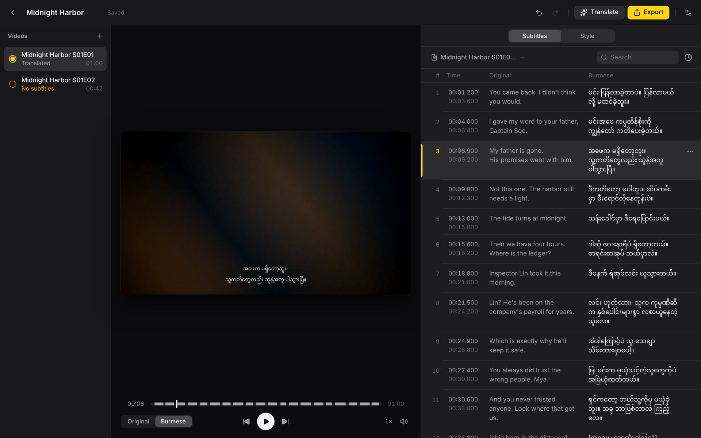

# MyOpenSub

MyOpenSub is a free desktop app that translates the subtitles a video already has, using AI, and burns the translation into the video or saves it as a subtitle file.



## Download

**[Download from the releases page](https://github.com/swanhtet1992/myopensub-releases/releases)**, then choose the one file for your computer. In each file name, `…` is the version number.

Version 0.1.0 is a pre-release: it is still being tested, so expect rough edges, and please [report what goes wrong](#problems).

| Your computer | File |
|---|---|
| Windows 10 or 11 (64-bit) | `MyOpenSub-…-windows-x64-setup.exe` |
| Mac with Apple silicon (M1 or later), macOS 14 or later | `MyOpenSub-…-macos-apple-silicon.dmg` |
| Linux (64-bit Intel or AMD): Debian, Ubuntu and other Debian-based systems | `MyOpenSub-…-linux-x64.deb` |
| Other Linux (64-bit Intel or AMD) | `MyOpenSub-…-linux-x64.AppImage` (needs FFmpeg installed) |

There is no version for Macs with an Intel processor.

MyOpenSub uses FFmpeg, a free program, to read and encode video. The Windows and Mac files include it. The Linux files do not:

- The `.deb` installs FFmpeg with it when you install it the usual way: open it with your system's software installer, or run `sudo apt install ./MyOpenSub-…-linux-x64.deb` with the version number in place of `…`.
- For the AppImage, install FFmpeg first, with `sudo apt install ffmpeg` or your distribution's own ffmpeg package. Without it, MyOpenSub opens on a screen that says FFmpeg is needed.

Each release also holds `SHA256SUMS.txt`, for checking that a download arrived complete and unchanged, and `THIRD-PARTY-NOTICES.md` (see [Licences](#licences)). You do not need either to install MyOpenSub.

## First launch

This release does not yet carry the developer signature that Windows and macOS look for, so both warn you the first time you open MyOpenSub. Here is how to get past the warning on each system. The steps for macOS 15 or later have been tried on a real Mac. The others are what we expect to happen, and are still being confirmed with testers during the pre-release.

### Windows

1. Your browser may hold the download back, saying the file is not commonly downloaded. Choose to keep it (in Edge: "Keep", then "Keep anyway").
2. Open the downloaded file. A blue box says "Windows protected your PC". Click "More info", then "Run anyway".

### macOS

Open the `.dmg` file and drag MyOpenSub onto the Applications folder next to it. Then, on macOS 15 or later:

1. Open MyOpenSub. A message says Apple could not verify it. Click "Done", not "Move to Trash".
2. Open System Settings, choose "Privacy & Security", and scroll down to the line saying MyOpenSub was blocked. Click "Open Anyway".
3. macOS asks once more. Choose "Open Anyway" again, and confirm with your password or Touch ID.

On macOS 14: hold Control and click MyOpenSub in Applications, choose "Open", then "Open" again in the message.

You do this only once. After that, MyOpenSub opens like any other app.

### Linux

The `.deb` needs nothing more: install it as described under [Download](#download).

The AppImage must be allowed to run before it will open. In your file manager, open the file's Properties and allow it to run as a program. Or use a terminal, with the version number in place of `…`:

```sh
chmod +x MyOpenSub-…-linux-x64.AppImage
./MyOpenSub-…-linux-x64.AppImage
```

If it does not start and the message mentions FUSE, add `--appimage-extract-and-run` to the end of the second line.

## What you need

MyOpenSub is free. To translate, it needs your own API key for Gemini (from Google), Claude (from Anthropic) or OpenRouter: a code from that service that lets MyOpenSub translate on your account there. Open Settings with the button at the top right of the window (or press Ctrl+, on Windows and Linux, ⌘, on a Mac), choose the service under "Translate with", paste the key and click Save. The "Get a key from …" link under the box opens the page where you create one.

## What leaves your computer

Your videos never leave your computer.

**When you translate,** the subtitle text, and the Context and the names and terms from the Translate window, go to the service you chose, with your key. OpenRouter passes them on to the company behind the model you picked.

**When you export a translation** (burned into the video, or as a subtitle file), that episode's lines are sent to an open dataset of translations, so future models translate better. The dataset is kept on a server run by MyOpenSub's developer. It has not been published yet, and the terms it will be published under have not been set. Contribute only text you are free to share; if you are not sure, switch contributing off. Here is what is sent and what is not:

| Sent | Never sent |
|---|---|
| Original and translated lines, with timing | Videos, audio, images |
| Which model wrote each line, and whether a person edited it | API keys |
| The names and terms, project name and video name | File locations, the Context you wrote, style, logo |
| The name you entered under "Credit as" in Settings, if any | Anything before an export: drafts stay on your computer |

Also sent: the two languages, the app's version, and a random code your copy of MyOpenSub made up so that it can later replace or delete what it sent. The server keeps only a scrambled form of that code.

**To turn this off,** switch off "Contribute this translation" in the Export window, or "Contribute exported translations" in Settings, under "Open dataset". Both are the same setting, and it is on by default.

**To delete what was sent,** open Settings and, under "Open dataset", next to "Already contributed", click "Delete from Dataset…", then "Delete". This deletes everything sent from this computer and turns contributing off. It works only from the copy of MyOpenSub that sent them: if its settings are lost, or on another computer, earlier contributions can no longer be deleted this way.

## Problems

[Open an issue](https://github.com/swanhtet1992/myopensub-releases/issues/new/choose) here on GitHub (this needs a GitHub account). Say which version you have (it is at the bottom of Settings) and which system you use. Never paste an API key into an issue.

## Licences

Using MyOpenSub is covered by the [terms of use](TERMS.md). It includes software and fonts from other projects, which stay under their own licences. They are listed in `THIRD-PARTY-NOTICES.md`, attached to every [release](https://github.com/swanhtet1992/myopensub-releases/releases) and installed with the app.
